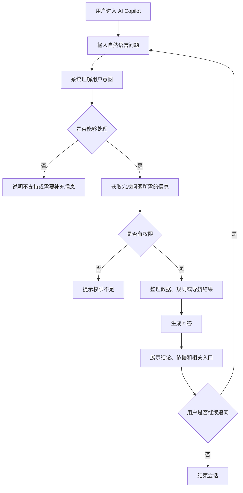

# 产品需求文档（PRD）

> 文档名称：`AI Copilot 运营助手 PRD`  
> 文档版本：`V1.0`  
> 产品负责人：`待定`  
> 参与人员：`产品、设计、研发、测试、运营`  
> 创建日期：`2026-09-15`  
> 最后更新：`2026-09-15`  
> 当前状态：`草稿`

---

## 1. 文档说明

### 1.1 文档目的

本文档用于明确 AI Copilot 运营助手的产品背景、目标用户、业务目标、功能范围、交互逻辑、业务规则、信息要求和验收标准，作为产品设计、UI/UX 设计、技术设计、研发、测试和上线验收的共同依据。

本文档仅描述产品和业务需求，不包含具体技术架构、模型接入、接口实现、权限传递、知识存储等技术实现细节。相关内容见《AI Copilot 技术实现设计》。

### 1.2 阅读对象

- 产品经理
- 项目经理
- UI/UX 设计师
- 前端工程师
- 后端工程师
- 测试工程师
- 运营团队
- 业务负责人

### 1.3 名词解释

| 名词 | 英文 / 缩写 | 说明 |
|---|---|---|
| AI Copilot | AI Copilot | 面向内部运营人员的统一 AI 运营入口 |
| 运营用户 | Operations User | 日常使用公司后台处理用户、资金、交易、KYC 等运营工作的内部人员 |
| 数据查询 | Data Query | 通过自然语言查找业务数据 |
| 数据解释 | Data Explanation | 对业务数据、字段、状态、计算结果和异常原因进行解释 |
| 规则问答 | Rule Q&A | 查询业务规则、处理规则、状态规则及相关说明 |
| 后台导航 | Admin Navigation | 告诉运营人员某项数据或功能应在现有后台的哪个位置查看或处理 |
| 业务语义 | Business Semantics | 对业务概念、字段和指标含义的标准化定义 |
| SOP | Standard Operating Procedure | 标准操作流程 |
| MVP | Minimum Viable Product | 最小可行产品 |

### 1.4 参考资料

| 资料名称 | 链接 / 位置 | 说明 |
|---|---|---|
| 通用 PRD 模板 | `PRD.md` | 本文档结构参考 |
| AI Copilot 技术实现设计 | `ai-copilot-technical-design.md` | 技术架构和实现说明 |
| 现有运营后台 | 内部系统 | 主要业务操作和查询入口 |
| 业务规则 / SOP | 内部资料 | 业务知识来源 |

---

## 2. 版本记录

| 版本 | 日期 | 修改人 | 修改内容 | 状态 |
|---|---|---|---|---|
| V0.1 | 2026-09-15 | 待定 | 根据需求讨论整理首版 | 草稿 |

---

## 3. 项目概述

### 3.1 项目背景

公司当前存在面向网站业务和中后台业务的多套系统。运营人员在日常工作中需要频繁查询用户、资金、订单、交易、KYC、佣金等业务数据，并理解相关数据的生成规则、业务含义和处理流程。

目前主要存在以下问题：

- 后台功能较多，运营人员无法快速判断某项数据应去哪里查询；
- 同一业务问题可能需要跨多个页面或模块查询；
- 部分数据字段、状态和计算结果的业务含义较复杂；
- 业务规则和操作流程存在学习成本；
- 新运营人员依赖口头培训、群聊询问或研发协助；
- 业务文档可能滞后于实际系统行为；
- 运营人员对现有后台不熟悉时，简单问题也可能需要产品或研发介入。

因此计划建设 AI Copilot 运营助手，为运营人员提供统一的自然语言入口。

运营人员不再需要先知道“该去哪个后台、哪个菜单、哪个页面”，而可以直接描述自己的问题，由系统帮助完成数据查询、数据解释、规则说明和后台导航。

### 3.2 问题定义

需要解决的核心问题：

1. 运营人员不知道某项数据应该在哪里查询；
2. 运营人员不熟悉字段、状态、金额和指标的业务含义；
3. 运营人员不熟悉数据生成、状态变化和业务处理规则；
4. 一个问题可能需要跨多个业务模块查询和综合判断；
5. 业务知识分散在后台、文档、代码和团队成员经验中；
6. 简单运营问题频繁依赖产品、研发或资深运营人员人工答疑。

典型问题：

> 对于运营人员，当其需要处理用户咨询、资金异常、交易问题或后台操作时，需要快速定位数据和理解业务原因，但当前由于后台复杂、知识分散、业务规则不透明，导致处理时间长、学习成本高，并增加跨团队沟通成本。

### 3.3 产品定位

AI Copilot 是一个面向公司内部运营人员的统一 AI 运营入口，通过自然语言交互提供数据查询、数据解释、规则问答和后台导航能力，帮助运营人员更高效地理解和使用现有业务系统。

AI Copilot 不是新的业务后台，也不替代现有运营后台。

现有后台继续负责：

- 精确查询；
- 复杂筛选；
- 业务操作；
- 审批；
- 数据维护；
- 批量处理。

AI Copilot 负责：

- 帮用户找到数据；
- 帮用户理解数据；
- 帮用户理解规则；
- 帮用户找到后台功能；
- 将多个相关信息整理成可理解的答案。

### 3.4 产品愿景

> 让运营人员无需熟记复杂后台结构和大量业务细节，也能够快速、准确地找到数据、理解数据和定位问题。

长期目标是使 AI Copilot 成为内部运营工作的自然语言入口。

### 3.5 核心价值

| 价值维度 | 价值描述 |
|---|---|
| 用户价值 | 降低后台使用和业务规则学习成本，提高问题处理效率 |
| 业务价值 | 减少重复咨询、人工答疑和跨部门沟通，提高运营团队整体效率 |
| 平台价值 | 将分散的业务数据、业务知识和后台入口统一组织成可查询能力 |
| 战略价值 | 为后续更复杂的 AI 分析、辅助决策和受控操作建立统一入口 |

---

## 4. 产品目标

### 4.1 业务目标

首期上线前缺乏可靠基线，因此以下指标以“上线后建立基线并持续优化”为原则。

| 目标 | 指标 | 当前值 | 目标值 | 统计周期 |
|---|---|---:|---:|---|
| 提升运营自助解决率 | 无需其他团队介入即可解决的问题占比 | 待建立基线 | 持续提升 | 月 |
| 降低问题处理时间 | 常见运营问题平均处理时长 | 待建立基线 | 相比基线显著下降 | 月 |
| 降低重复咨询 | 运营向产品/研发重复咨询次数 | 待建立基线 | 相比基线下降 | 月 |
| 提高回答有效性 | 用户认为“已解决/有帮助”的会话占比 | 待建立基线 | 持续提升 | 周 |
| 提高导航成功率 | 后台导航回答后成功进入目标功能的比例 | 待建立基线 | 持续提升 | 月 |

### 4.2 用户目标

- 用户能够直接使用自然语言描述业务问题；
- 用户无需提前知道业务模块或后台菜单位置；
- 用户能够快速获取自己有权限查看的数据；
- 用户能够理解关键字段、状态、金额和指标的含义；
- 用户能够理解数据产生或状态变化的主要原因；
- 用户能够查询业务规则和常见操作流程；
- 用户能够从回答中直接进入相关后台页面；
- 用户能够明确区分事实数据、规则说明和系统无法确认的信息。

### 4.3 产品目标

首期产品目标：

- 建立统一的 AI 运营入口；
- 支持数据查询；
- 支持数据解释；
- 支持规则问答；
- 支持后台导航；
- 支持多轮追问；
- 回答中展示清晰的数据来源或依据；
- 严格遵守当前用户的数据访问权限；
- 对无法确认的问题明确说明，不生成未经验证的业务结论；
- 为未来写入操作、复杂分析和自动化能力保留产品演进空间。

### 4.4 非目标

首期明确不解决：

- 不替代现有运营后台；
- 不重新建设后台 CRUD 功能；
- 不支持 AI 自动修改业务数据；
- 不支持 AI 自动审批；
- 不支持 AI 自动冻结、解冻、调整余额等高风险操作；
- 不将 AI 回答作为最终审计或合规决策依据；
- 不要求覆盖公司全部业务领域；
- 不追求一次上线即可回答所有内部业务问题；
- 不建设面向外部客户的 AI 客服产品；
- 不在首期提供自动化业务决策。

---

## 5. 用户与角色

### 5.1 目标用户

| 用户类型 | 用户特征 | 核心需求 | 使用频率 |
|---|---|---|---|
| 一线运营 | 高频使用后台处理用户、资金、订单等问题 | 快速查询、理解原因、找到处理入口 | 高 |
| 资深运营 | 熟悉业务但需要跨模块调查复杂问题 | 跨数据查询、规则核对、快速定位 | 高 |
| 运营主管 | 需要协助团队判断问题和确认规则 | 快速了解情况、核实业务依据 | 中 |
| 产品/客服支持 | 经常回答运营业务问题 | 快速定位现有规则和数据 | 中 |
| 其他内部授权人员 | 偶尔查询业务信息 | 降低后台学习成本 | 低 |

### 5.2 权限原则

- 用户必须使用内部身份登录后才能使用；
- AI Copilot 不扩大用户原有数据权限；
- 用户仅能查询其当前账号已有权限访问的信息；
- 无权限数据不得因 AI 问答而被展示；
- 当用户请求无权限内容时，应明确提示无权限，而不是返回部分敏感信息；
- 后续新增写操作时，需要单独定义更严格的操作权限和确认机制。

---

## 6. 用户场景与用户旅程

### 6.1 核心使用场景

#### 场景一：数据查询

- 使用角色：运营人员
- 触发条件：需要查询某个用户、订单、资金、交易或其他业务对象
- 用户目标：无需寻找后台页面即可直接获得目标数据
- 前置条件：用户已登录且拥有对应数据权限
- 主流程：输入自然语言问题 → 系统理解查询对象 → 返回查询结果 → 用户查看数据或进入后台详情
- 预期结果：获得准确、结构清晰且符合权限范围的数据

示例：

> 查询用户 123456 最近 30 天的入金记录。

#### 场景二：数据解释

- 使用角色：运营人员
- 触发条件：用户看到了数据，但不知道其含义或为什么产生该结果
- 用户目标：理解字段、状态、金额、指标或计算结果
- 前置条件：相关数据可被查询
- 主流程：提出“为什么/是什么意思”类问题 → 系统获取相关数据和规则 → 给出原因解释
- 预期结果：用户理解结果的组成、业务含义和主要影响因素

示例：

> 为什么这个用户还有余额，但可提现金额只有 200 USDT？

#### 场景三：规则问答

- 使用角色：运营人员
- 触发条件：用户不确定某项业务规则、限制条件或处理要求
- 用户目标：获得当前有效的业务规则说明
- 前置条件：系统存在可用的规则或依据
- 主流程：提出规则问题 → 系统查询相关业务知识 → 返回规则和适用范围
- 预期结果：用户明确知道当前规则以及必要的注意事项

示例：

> 用户存在审核中的提现时还能重新申请提现吗？

#### 场景四：后台导航

- 使用角色：运营人员
- 触发条件：用户知道想做什么，但不知道后台入口
- 用户目标：快速找到目标页面或功能
- 前置条件：目标功能存在且用户拥有访问权限
- 主流程：描述需求 → 系统匹配后台功能 → 返回菜单路径和可点击入口
- 预期结果：用户可直接进入目标后台功能

示例：

> 哪里可以查用户的登录记录？

#### 场景五：综合问题调查

- 使用角色：运营人员、资深运营
- 触发条件：一个业务问题需要结合多个信息判断
- 用户目标：减少在多个后台页面间切换和手工比对
- 前置条件：用户拥有相关信息访问权限
- 主流程：提出问题 → 系统获取多个相关信息 → 综合整理 → 给出结论、依据和相关入口
- 预期结果：用户可以快速了解问题全貌，并继续进入后台核实

示例：

> 用户 123456 为什么不能提现？

### 6.2 用户故事

| 编号 | 用户故事 | 优先级 |
|---|---|---|
| US-001 | 作为运营人员，我希望直接描述我要查的数据，从而不用寻找具体后台页面 | P0 |
| US-002 | 作为运营人员，我希望系统解释字段和金额的含义，从而减少业务理解错误 | P0 |
| US-003 | 作为运营人员，我希望询问业务规则，从而减少向产品或研发重复确认 | P0 |
| US-004 | 作为运营人员，我希望系统告诉我后台入口，从而快速进入现有功能 | P0 |
| US-005 | 作为运营人员，我希望对回答继续追问，从而逐步缩小问题范围 | P0 |
| US-006 | 作为运营人员，我希望知道答案依据了哪些数据或规则，从而判断答案可信度 | P0 |
| US-007 | 作为运营人员，我希望查询结果能够以表格、时间线或关键信息卡展示，从而提高阅读效率 | P1 |
| US-008 | 作为运营人员，我希望从回答直接打开相关后台页面，从而继续处理业务 | P1 |
| US-009 | 作为运营主管，我希望能够收集常见未解决问题，从而发现后台和培训中的知识缺口 | P2 |
| US-010 | 作为运营人员，我希望未来可以在确认后让 AI 执行受控操作，从而进一步减少重复步骤 | P3 |

---

## 7. 产品范围

### 7.1 本期范围

本期包含：

- AI 统一问答入口；
- 数据查询；
- 数据解释；
- 规则问答；
- 后台导航；
- 多轮上下文追问；
- 结构化结果展示；
- 相关后台入口跳转；
- 用户权限约束；
- 回答依据和来源提示；
- 错误、无结果、无权限和信息不足等异常反馈；
- 常用问题快捷入口；
- 用户反馈能力。

首期优先覆盖高频业务领域，建议从以下领域开始：

- 用户；
- 入金；
- 出金；
- 交易 / 订单；
- KYC；
- IB / 佣金。

最终首期领域以真实运营问题频率确认。

### 7.2 本期不包含

- 写入或修改业务数据；
- AI 自动审批；
- AI 自动执行资金相关操作；
- AI 自动执行账户限制；
- 自动生成最终合规判断；
- 大规模知识库建设；
- 面向外部客户开放；
- 全业务范围一次性覆盖；
- 自动生成复杂经营报表；
- 自主长时间执行无人监督任务。

### 7.3 功能优先级

优先级定义：

- **P0**：核心功能，缺失则产品无法上线；
- **P1**：重要功能，显著影响用户体验或业务效率；
- **P2**：增强功能，可延后上线；
- **P3**：探索功能，进入后续规划。

| 功能模块 | 功能点 | 优先级 | 本期是否实现 |
|---|---|---:|---:|
| AI 对话 | 自然语言提问 | P0 | 是 |
| AI 对话 | 多轮追问 | P0 | 是 |
| 数据查询 | 查询业务数据 | P0 | 是 |
| 数据解释 | 字段、状态和结果解释 | P0 | 是 |
| 规则问答 | 查询业务规则 | P0 | 是 |
| 后台导航 | 返回后台菜单与页面入口 | P0 | 是 |
| 权限 | 严格遵守现有用户权限 | P0 | 是 |
| 回答可信度 | 显示数据/规则依据 | P0 | 是 |
| 结果展示 | 表格、卡片、时间线 | P1 | 是 |
| 快捷入口 | 常用问题模板 | P1 | 是 |
| 用户反馈 | 有帮助 / 无帮助 | P1 | 是 |
| 历史会话 | 查看历史问题 | P2 | 可选 |
| 写操作 | 修改业务数据 | P3 | 否 |
| 自动决策 | 自动执行业务决策 | P3 | 否 |

---

## 8. 产品信息架构

### 8.1 产品结构

```text
AI Copilot
├── AI 对话
│   ├── 问题输入
│   ├── 推荐问题
│   ├── 对话结果
│   └── 多轮追问
├── 结果展示
│   ├── 结论
│   ├── 解释
│   ├── 数据
│   ├── 规则依据
│   ├── 相关后台入口
│   └── 异常 / 限制说明
├── 常用能力
│   ├── 数据查询
│   ├── 数据解释
│   ├── 规则问答
│   └── 后台导航
└── 用户辅助
    ├── 使用提示
    ├── 问题示例
    └── 回答反馈
```

### 8.2 页面清单

| 页面编号 | 页面名称 | 页面类型 | 使用角色 | 说明 |
|---|---|---|---|---|
| PAGE-001 | AI Copilot 首页 | 内部工具 | 授权内部用户 | 统一提问入口 |
| PAGE-002 | 对话页 | 内部工具 | 授权内部用户 | 展示多轮问答、数据和业务解释 |
| PAGE-003 | 使用帮助 | 内部工具 | 授权内部用户 | 展示支持范围和问题示例 |
| PAGE-004 | 历史会话 | 内部工具 | 授权内部用户 | 查看历史问答，可作为后续增强 |

---

## 9. 核心业务流程

### 9.1 主业务流程



### 9.2 问题处理类型

| 问题类型 | 典型输入 | 预期输出 |
|---|---|---|
| 数据查询 | “查用户 123 最近的提现” | 结构化数据 + 相关后台入口 |
| 数据解释 | “为什么只能提 200？” | 结论 + 关键数据 + 原因 |
| 规则问答 | “提现审核中还能再次申请吗？” | 规则 + 适用条件 + 注意事项 |
| 后台导航 | “登录记录在哪里查？” | 菜单路径 + 页面入口 |
| 综合问题 | “这个用户为什么不能提现？” | 综合结论 + 数据 + 规则 + 页面入口 |

### 9.3 异常流程

- 用户输入信息不足；
- 用户问题存在歧义；
- 无法识别业务对象；
- 查询不到数据；
- 用户无权限查看目标数据；
- 当前业务领域暂未支持；
- 相关业务知识无法确认；
- 数据与规则之间存在冲突；
- 系统暂时不可用；
- 回答置信度不足。

异常处理原则：

- 不猜测关键业务事实；
- 无权限时明确提示；
- 无数据时区分“没有记录”和“查询失败”；
- 无法确认规则时明确说明；
- 必要时引导用户进入现有后台或联系对应业务负责人。

---

## 10. 功能需求

### 10.1 功能模块：AI 对话入口

#### 10.1.1 模块目标

提供统一、低学习成本的自然语言入口，使运营人员无需了解后台结构即可提出问题。

#### 10.1.2 使用角色

- 一线运营
- 资深运营
- 运营主管
- 其他授权内部人员

#### 10.1.3 前置条件

- 用户已登录；
- 用户拥有 AI Copilot 使用权限。

#### 10.1.4 功能清单

| 功能编号 | 功能名称 | 功能说明 | 优先级 |
|---|---|---|---:|
| F-001 | 自然语言提问 | 用户使用自然语言输入业务问题 | P0 |
| F-002 | 多轮追问 | 支持基于当前上下文继续提问 | P0 |
| F-003 | 推荐问题 | 展示常用问题示例 | P1 |
| F-004 | 加载状态 | 明确展示系统正在处理 | P0 |
| F-005 | 回答反馈 | 用户可标记回答是否有帮助 | P1 |

#### 10.1.5 业务规则

- 用户问题应允许使用日常业务语言，不要求输入固定命令；
- 系统应尽量识别用户编号、订单号、业务状态等关键对象；
- 信息不足但仍可合理继续时，应优先提供当前可确认的信息；
- 只有确实无法继续时才要求用户补充必要信息；
- 多轮对话应继承当前会话中已经确认的业务对象和上下文；
- 不得因上下文混淆而将一个用户的数据错误关联到另一个用户。

#### 10.1.6 验收标准

- 用户可以提交自然语言问题；
- 可以连续追问同一业务问题；
- 会话中已明确的信息无需重复输入；
- 不支持的问题能够得到清晰提示；
- 系统异常不会造成用户误认为业务结论成立。

---

### 10.2 功能模块：数据查询

#### 10.2.1 模块目标

允许运营人员通过自然语言查询其权限范围内的业务数据。

#### 10.2.2 典型查询

- 用户基本信息；
- 用户账户状态；
- 入金记录；
- 出金记录；
- 订单 / 交易记录；
- KYC 状态；
- IB / 佣金信息；
- 后续确认的其他高频查询。

#### 10.2.3 展示形式

根据数据类型选择：

- 单值；
- 关键信息卡；
- 表格；
- 时间线；
- 摘要 + 明细。

#### 10.2.4 业务规则

- 只展示用户有权查看的数据；
- 查询结果必须明确业务对象，避免用户混淆；
- 存在多条记录时应提供足够的识别字段；
- 对时间、金额、状态等信息使用统一展示方式；
- 默认优先展示与问题直接相关的结果，而不是返回大量无关字段；
- 当数据量过大时，应提醒用户缩小范围或仅展示摘要。

#### 10.2.5 验收标准

- 查询结果与现有业务系统一致；
- 无权限字段不展示；
- 无记录时清晰提示“未查询到记录”；
- 失败时不能伪装成“无数据”；
- 常见业务对象能够通过自然语言完成查询。

---

### 10.3 功能模块：数据解释

#### 10.3.1 模块目标

帮助运营人员理解数据字段、业务状态、金额构成、指标和异常结果。

#### 10.3.2 支持类型

- 字段含义；
- 状态含义；
- 金额含义；
- 指标含义；
- 数据来源；
- 计算组成；
- 状态变化原因；
- 数据之间的关系；
- “为什么”类业务问题。

#### 10.3.3 回答结构

对于复杂解释，优先采用：

1. 结论；
2. 当前关键数据；
3. 原因说明；
4. 适用规则；
5. 相关后台入口；
6. 必要的限制或不确定性说明。

#### 10.3.4 业务规则

- 不应将相似业务概念混为一谈；
- 对容易混淆的字段应明确差异；
- 如果结论依赖多个数据项，应展示关键组成；
- 如果系统无法证明某个原因，只能表述为“无法确认”，不得推测为事实；
- 若存在多个可能原因，应明确已确认和未确认部分。

#### 10.3.5 验收标准

- 常见核心字段能够得到一致解释；
- 常见金额和状态能够解释主要组成或变化原因；
- 回答能够区分“事实数据”和“解释”；
- 不确定信息有明确提示。

---

### 10.4 功能模块：规则问答

#### 10.4.1 模块目标

为运营人员提供统一的业务规则查询入口。

#### 10.4.2 支持内容

- 业务状态规则；
- 数据生成规则；
- 金额计算规则；
- 提交限制；
- 审核规则；
- 运营处理规范；
- 常用 SOP；
- 规则适用条件；
- 规则例外情况。

#### 10.4.3 回答结构

建议包含：

- 规则结论；
- 适用场景；
- 触发条件；
- 例外或限制；
- 相关业务对象；
- 依据；
- 相关后台入口。

#### 10.4.4 业务规则

- 规则回答必须基于当前系统可确认的信息；
- 已知资料过期或无法确认时，应显式提醒；
- 不允许使用过时规则覆盖当前真实业务行为；
- 对重要规则应尽可能提供可核查依据；
- 如果业务规则存在版本差异，应明确适用范围。

#### 10.4.5 验收标准

- 高频规则问题可以得到一致回答；
- 用户能够理解规则是否适用于当前问题；
- 无法确认的规则不会被包装成确定答案。

---

### 10.5 功能模块：后台导航

#### 10.5.1 模块目标

让用户通过描述想查询或处理的业务事项，快速找到现有后台对应功能。

#### 10.5.2 展示内容

- 页面名称；
- 菜单路径；
- 页面说明；
- 相关业务能力；
- 可点击入口；
- 必要权限提示。

#### 10.5.3 典型示例

用户：

> 哪里可以查用户登录记录？

系统：

> 你可以进入：
>
> 用户管理 → 用户详情 → 登录记录
>
> [打开后台页面]

#### 10.5.4 业务规则

- 只推荐真实存在的后台页面；
- 用户无权限时不应提供可能绕过权限的入口；
- 页面名称发生变化后应保持导航信息一致；
- 一个问题存在多个相关页面时，应说明每个页面的用途；
- 优先给出最直接的页面，而不是要求用户逐层搜索。

#### 10.5.5 验收标准

- 高频后台功能可以通过自然语言找到；
- 返回路径与实际后台一致；
- 链接能够进入目标页面；
- 无权限页面得到正确提示。

---

### 10.6 功能模块：综合问题分析

#### 10.6.1 模块目标

针对需要多个数据和规则才能回答的问题，自动汇总相关信息，帮助运营人员快速定位原因。

#### 10.6.2 示例

> 用户 123456 为什么不能提现？

预期回答可包含：

- 当前是否可提现；
- 影响提现的关键状态；
- 相关金额；
- 未完成提现；
- 账户或业务限制；
- 适用业务规则；
- 相关后台入口。

#### 10.6.3 业务规则

- 只围绕用户问题查询必要的信息；
- 结论必须能够由已获取的信息支持；
- 必须区分“已确认原因”和“可能原因”；
- 复杂问题应优先给结论，再展示依据；
- 不应向普通用户暴露大量内部无关细节。

#### 10.6.4 验收标准

- 可以完成至少一批预定义的高频综合问题；
- 回答中的关键结论有对应数据或规则依据；
- 查询失败不会导致错误结论。

---

### 10.7 功能模块：回答与结果展示

#### 10.7.1 展示结构

回答可由以下内容组成：

- 结论；
- 关键数据；
- 解释；
- 规则依据；
- 数据表格；
- 时间线；
- 后台入口；
- 权限提示；
- 风险或不确定性提示。

#### 10.7.2 展示原则

- 结论优先；
- 避免大段无结构文字；
- 关键数字突出；
- 数据和解释分开；
- 相关后台入口可直接点击；
- 复杂查询优先使用表格和时间线；
- 技术实现细节不得直接展示给运营用户。

#### 10.7.3 验收标准

- 常见数据能够以易读形式展示；
- 运营用户无需阅读底层技术信息即可理解答案；
- 重要限制和异常不会被隐藏。

---

### 10.8 功能模块：权限与数据安全

#### 10.8.1 功能目标

保证 AI Copilot 不扩大现有内部系统权限边界。

#### 10.8.2 业务规则

- AI Copilot 使用用户现有身份和权限；
- 用户只能访问原本就有权访问的数据；
- 无权限信息不得通过推断、摘要、关联结果等方式间接泄露；
- 敏感数据的展示规则与现有后台保持一致；
- 用户跨会话不能访问其他用户的上下文；
- 对权限不足必须给出明确反馈。

#### 10.8.3 验收标准

- 相同用户在 AI Copilot 和现有后台的数据可见范围一致；
- 无权限数据不会出现在结果、解释或摘要中；
- 不同权限角色的回答结果符合各自权限范围。

---

### 10.9 功能模块：回答反馈

#### 10.9.1 功能目标

持续收集运营人员对回答质量的反馈，用于发现问题、补充知识和调整支持范围。

#### 10.9.2 功能内容

- 有帮助；
- 无帮助；
- 可选反馈原因；
- 可选文本补充。

建议原因：

- 数据不正确；
- 规则不正确；
- 没有回答问题；
- 找不到对应后台；
- 结果不完整；
- 表达难理解；
- 其他。

#### 10.9.3 验收标准

- 用户可以对回答进行反馈；
- 反馈不打断正常使用；
- 产品团队可以统计高频失败类型。

---

## 11. 后续规划

### 11.1 下一阶段

在 MVP 稳定后，根据真实使用情况逐步评估：

- 扩展更多业务领域；
- 增强跨模块综合分析；
- 建立更完善的业务知识维护机制；
- 增加历史会话和收藏；
- 增加运营问题分析看板；
- 支持更多结构化结果组件；
- 优化规则和导航信息的维护效率；
- 根据知识规模决定是否需要更高级的知识检索能力。

### 11.2 长期规划

| 阶段 | 产品目标 | 主要能力 |
|---|---|---|
| 第一阶段 | 验证核心需求 | 统一 AI 入口、数据查询、数据解释、规则问答、后台导航 |
| 第二阶段 | 提升覆盖和准确性 | 扩展业务领域、综合分析、知识治理、质量反馈 |
| 第三阶段 | 增强运营协作 | 辅助调查、任务建议、受控操作建议 |
| 第四阶段 | AI 运营助手升级 | 经人工确认的写操作、流程自动化、辅助决策 |

长期仍需坚持：

> AI Copilot 是现有业务系统的智能入口和协作层，而不是脱离现有系统重新建设一套后台。
